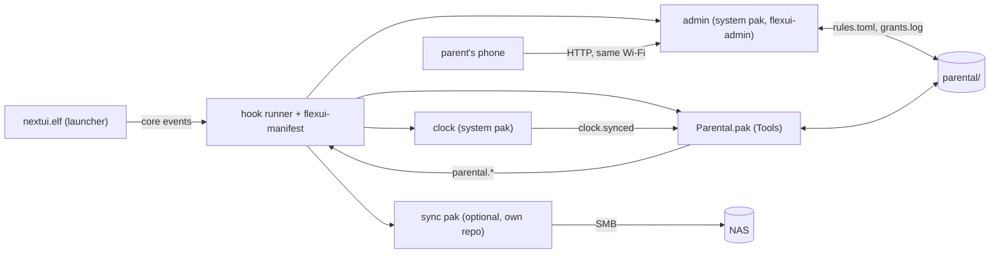
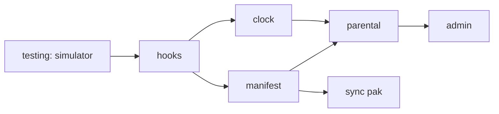

# FlexUI OS — specification overview

FlexUI becomes a firmware for **one device, the TrimUI Brick (`tg5040`)**, based
on NextUI: a public hook API, parental control built on it, an admin page served
by the console, and an optional NAS sync. This page is the map; the specs in
[specs/](specs/index.md), by domain, are the detail.

| Section | Content |
|---|---|
| [Principles](#principles) | Rules every domain follows |
| [Components](#components) | What runs where |
| [Domains](#domains) | The specs, and the order to build them in |
| [Contracts](#contracts) | Events, files, and who writes them |
| [Open questions](#open-questions) | Cross-domain decisions still pending |

## Principles

| Principle | Consequence | Set in |
|---|---|---|
| Brick only, assumed divergence | The code is ours; upstream is a source, not a constraint | [licence](specs/project/licence.md) |
| Everything is a pak on a public API | Parental control, clock, admin and sync have no privileged path | [hooks](specs/core/hooks.md) |
| An activity never pays | No server, sync or heavy work competes with a game | [admin server](specs/admin/server.md#activation-rule) |
| No NAS, no Internet assumed | The OS and its admin work on a home network, or on nothing | [admin server](specs/admin/server.md#what-it-is-for) |
| Deterrent threat model | PIN, pairing cookie, clear text on the LAN; no signing, no encryption | [below](#threat-model) |
| The clock is not trusted | Counters and sizes order things, never timestamps | [clock](specs/core/clock.md) |
| Spare the SD card | Append-only files, buffering in `/tmp`, rotation | [hooks](specs/core/hooks.md#logging) |

### Threat model

One child, one parent acting as admin. The SD card is removable and readable on
any PC. The target is a deterrent, enough for a young child: a child editing
files from a computer, or changing the clock in Settings, is out of scope.

## Components

| Component | Kind | Role | Spec |
|---|---|---|---|
| Hook runner (`pak-hooks.sh`, `flexui-emit`) | Core | Discovers subscribers, runs events, logs | [hooks](specs/core/hooks.md) |
| `flexui-manifest` | Core, C | Validates manifests, synthesizes legacy ones, caches in `/tmp` | [manifest](specs/core/manifest.md) |
| `clock` | System pak | One-shot NTP, trusted-time state | [clock](specs/core/clock.md) |
| `admin` (`flexui-admin`) | System pak, C + civetweb | Page and JSON API, in the menus only | [admin](specs/admin/server.md) |
| `Parental.pak` | Tools pak | Budgets, windows, enforcement, history, stats recording | [parental](specs/parental/rules.md) |
| Sync pak | Official, optional, own repo | SMB links with per-folder policies | [sync](specs/sync/sync.md) |

## Domains

| Domain | Specs | Builds on |
|---|---|---|
| Core | [hooks](specs/core/hooks.md), [manifest](specs/core/manifest.md), [clock](specs/core/clock.md) | — |
| Parental | [rules](specs/parental/rules.md), [enforcement](specs/parental/enforcement.md), [data](specs/parental/data.md) | Core |
| Admin | [server](specs/admin/server.md), [pairing](specs/admin/pairing.md), [interface](specs/admin/interface.md) | Core, parental data |
| Sync | [sync](specs/sync/sync.md) | Hooks, manifest |
| Project | [licence](specs/project/licence.md), [testing](specs/project/testing.md) | — |

Build order:

The simulator exists ([testing](specs/project/testing.md)); the README and
`NOTICE` work of [licence](specs/project/licence.md) can land at any time.

## Contracts

### Events

| Namespace | Events | Emitted by |
|---|---|---|
| Core | `pre-launch`, `post-launch`, `activity-start`, `activity-stop`, `boot`, `shutdown`, `sleep`, `wake`, `charge-start`, `charge-stop`, `battery-low`, `wifi-connected`, `wifi-lost`, `pak-installed` | The OS |
| `clock.` | `synced` | `clock` |
| `parental.` | `budget-low`, `budget-exhausted`, `window-closed`, `extra-time-granted` | Parental.pak |
| `sync.` | `start`, `done`, `content-received` | Sync pak |

Synchronous with veto: `pre-launch`, `sleep`. Synchronous without veto:
`post-launch`. Everything else runs in the background.

### Files

| Path | Written by | Spec |
|---|---|---|
| `<pak>/manifest.toml` | Pak author | [manifest](specs/core/manifest.md) |
| `$LOGS_PATH/hooks.txt` | Hook runner, rotated at 256 KB × 2 | [hooks](specs/core/hooks.md#logging) |
| `parental/rules.toml`, `grants.log` | Admin server, Parental.pak menu | [data](specs/parental/data.md#files) |
| `parental/today.toml`, `activity.log`, `stats.log` | Parental.pak only | [data](specs/parental/data.md#files) |
| `parental/phones.toml` | Parental.pak pairing screen | [pairing](specs/admin/pairing.md) |
| Sync config and state | Sync pak | [sync](specs/sync/sync.md) |

`parental/` lives under `SHARED_USERDATA_PATH`, outside every synced folder.

## Open questions

Each spec lists its own. These ones cross domains or block one:

| Question | Domains | Blocks |
|---|---|---|
| A veto hook that times out: allow or refuse? | Hooks, parental | Parental enforcement when its hook hangs |
| Keep `.hooks/<event>.d/` user scripts? | Hooks | Compatibility with existing user hooks |
| Which sleeps can `sleep` veto? | Hooks, sync | Sync's sleep veto |
| A toast API for paks | Hooks, parental, sync | End-of-sync message |
| Admin pages owned by paks | Admin, sync | Typing NAS credentials in the admin web |
| Admin server on the pairing screen | Admin | Pairing at all |
| Exceptional days: drop, or one-day holiday periods? | Parental, admin | The Calendar screen |
| Does the Brick keep time when off? | Clock, parental | Budget day on cold boot |
